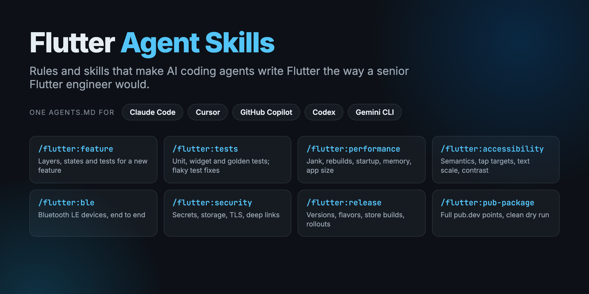

# Flutter Agent Skills

[](https://github.com/ChandraChaan/flutter-agent-skills/actions/workflows/ci.yml)
[](LICENSE)
[](#claude-code-plugin)
[](#rules-for-any-agent)

<p align="center">
  
</p>

**Rules and skills that make AI coding agents write Flutter code the way a senior Flutter engineer would.**

Coding agents are good at Flutter syntax and bad at Flutter judgement. Left alone they put logic in `build()`, use `BuildContext` after `await`, hard-code colours and strings, store tokens in `SharedPreferences`, skip error states, and say "done" without running the analyzer. This repository gives them:

- **Rules** (`AGENTS.md`): the conventions of a production Flutter codebase, in a form every major agent reads
- **Skills**: step-by-step playbooks for the jobs that need more than conventions, like building a feature with all its states and tests, or auditing performance
- **An example app** built by following them, analysed with the strict lint set and tested in CI, so you can see the rules produce code that passes

## Skills

| Skill | What it does |
|---|---|
| `/flutter:feature` | Builds a feature in layers (domain, data, presentation) with Riverpod 3, loading/error/empty states, accessibility checks and tests |
| `/flutter:tests` | Writes unit, widget and golden tests with fakes; fixes flaky and hanging tests |
| `/flutter:performance` | Profiles jank, rebuilds, startup, memory, idle animations and app size, and fixes the cause |
| `/flutter:accessibility` | Audits semantics, tap targets, text scaling and contrast, and adds automated guideline tests |
| `/flutter:ble` | Adds Bluetooth LE: permissions, connection lifecycle, MTU, parsing GATT data, testing without hardware |
| `/flutter:security` | Reviews secrets, token storage, logging, TLS and pinning, deep links and release configuration |
| `/flutter:release` | Prepares a release: version, flavors, obfuscated builds, store checklists, staged rollout |
| `/flutter:pub-package` | Gets a package to full pub.dev points and a clean publish dry run (but never publishes for you) |

Skills that could do something irreversible (publishing, uploading, signing) stop and hand you the command instead.

## Install

### Claude Code plugin

```text
/plugin marketplace add ChandraChaan/flutter-agent-skills
/plugin install flutter@flutter-agent-skills
```

Claude Code uses the skills automatically when a task matches, or you can call one directly, for example `/flutter:feature add an expenses screen`.

Then add the rules to your project (see below) so every task follows them.

### Rules for any agent

From a clone of this repository:

```bash
git clone https://github.com/ChandraChaan/flutter-agent-skills.git
flutter-agent-skills/scripts/install.sh rules path/to/your_flutter_app
```

This adds, without overwriting anything that exists:

| File | Read by |
|---|---|
| `AGENTS.md` | Codex, Cursor, GitHub Copilot, Jules, Zed, Windsurf and others; Gemini CLI with `"contextFileName": "AGENTS.md"` in its settings |
| `CLAUDE.md` | Claude Code (it imports `AGENTS.md`) |
| `.cursor/rules/*.mdc` | Cursor, scoped by file: UI rules for `lib/`, test rules for `test/` |
| `.github/copilot-instructions.md` | GitHub Copilot |

Then edit the **This project** section at the top of `AGENTS.md` (state management, routing, code generation, platforms) and delete any rule that doesn't fit your codebase. The rules say to follow existing code when it disagrees, so they're safe to add to an old project.

Optionally adopt the strict lint set in [`rules/analysis_options.yaml`](rules/analysis_options.yaml).

### Skills without the plugin

```bash
flutter-agent-skills/scripts/install.sh skills path/to/your_flutter_app   # project: .claude/skills/
flutter-agent-skills/scripts/install.sh skills --user                     # personal: ~/.claude/skills/
```

Installed this way they're named `flutter-feature`, `flutter-tests` and so on. The skills follow the open Agent Skills format (a folder with a `SKILL.md`), so agents that support skills can use the same folders.

## What the rules cover

[`rules/AGENTS.md`](rules/AGENTS.md) is about 100 lines. Highlights:

- **Definition of done:** `dart format`, `flutter analyze` and `flutter test` must pass; no `// ignore:` to silence lints; never edit generated files
- **Architecture:** feature-first folders, layers that only import inwards, repository interfaces, immutable models, money as integer minor units, UTC times
- **Riverpod 3:** `watch` in build, `read` in callbacks, `AsyncValue` handled with `switch`, `ref.mounted` after `await`
- **Widgets:** no hard-coded colours or strings, `context.mounted` after `await`, disposal, layouts that survive 320 px and 200% text
- **Accessibility, errors, networking, security, testing and performance** rules an agent can check itself against

## The example app

[`example_app/`](example_app) is a small expenses app built by following the rules and the `feature` skill: domain, data and presentation layers, Riverpod 3, localised strings, and 12 tests covering the controller, every screen state, the add flow, accessibility guidelines, and a 320 px screen with 200% text.

```bash
cd example_app
flutter test
```

## Contributing

Improvements from real projects are very welcome: a rule your team relies on, a mistake you keep seeing agents make, a new skill. Read [CONTRIBUTING.md](CONTRIBUTING.md) first, and share what worked (or didn't) in [Discussions](https://github.com/ChandraChaan/flutter-agent-skills/discussions).

```bash
python scripts/validate.py            # skills, manifests, docs
python scripts/build_rules.py         # regenerate Cursor and Copilot files after editing AGENTS.md
```

## Related

- [Mobile System Design](https://github.com/ChandraChaan/mobile-system-design): case studies for mobile system design interviews
- [Flutter Architect Handbook](https://github.com/ChandraChaan/flutter-architect-handbook): 67 interview questions, junior to architect
- [flutter-production-starter](https://github.com/ChandraChaan/flutter-production-starter): a template app with the same architecture
- [ble_gatt_parser](https://pub.dev/packages/ble_gatt_parser) and [ble_device_simulator](https://pub.dev/packages/ble_device_simulator): used by the `ble` skill

## License

MIT. See [LICENSE](LICENSE).
